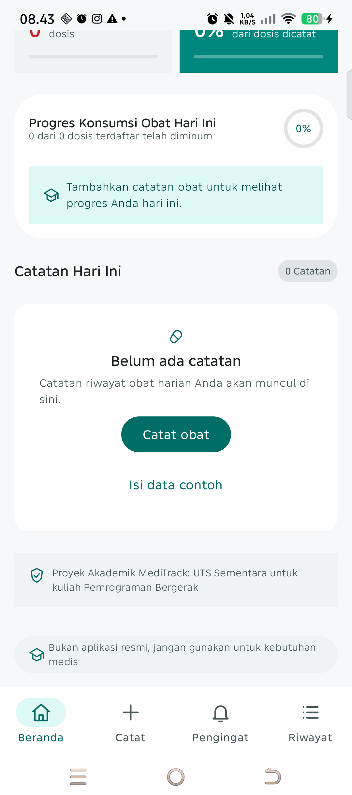
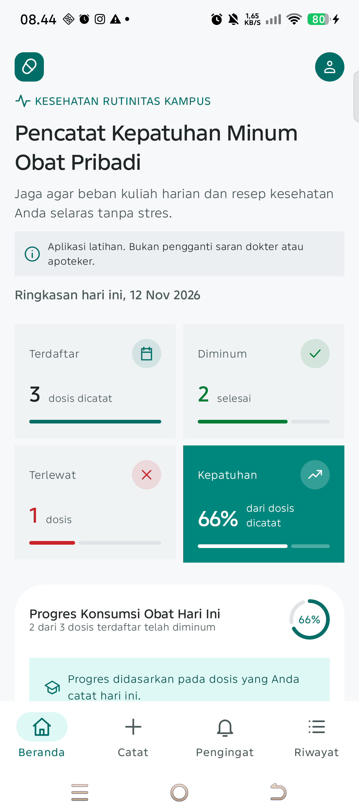
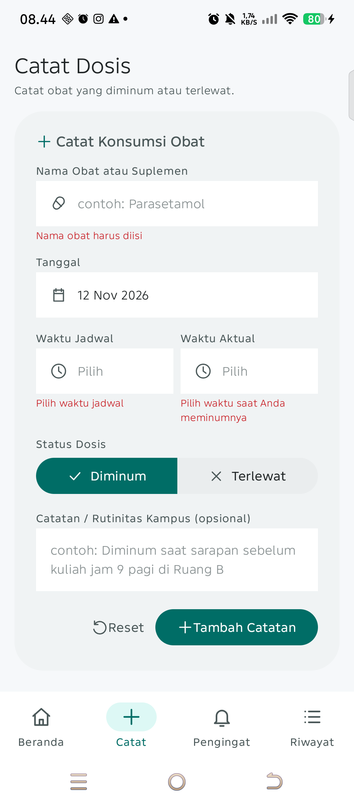
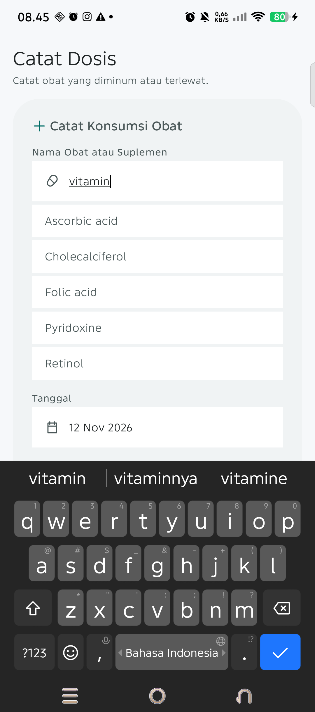
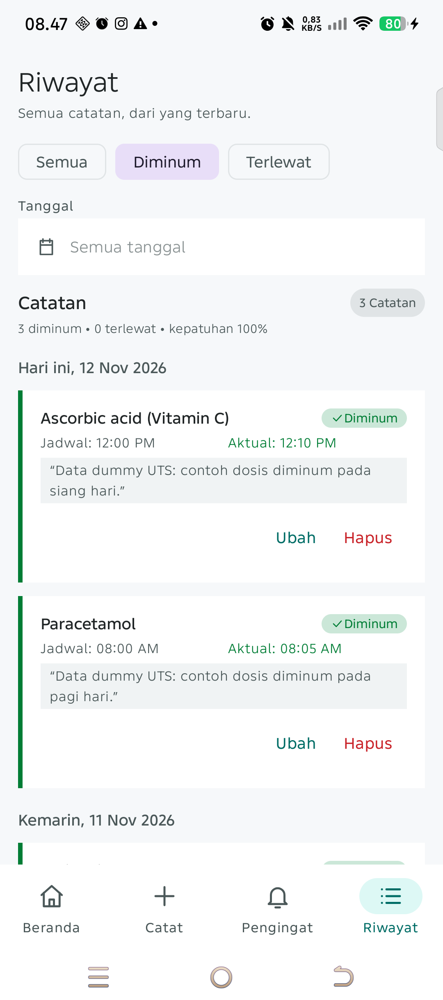
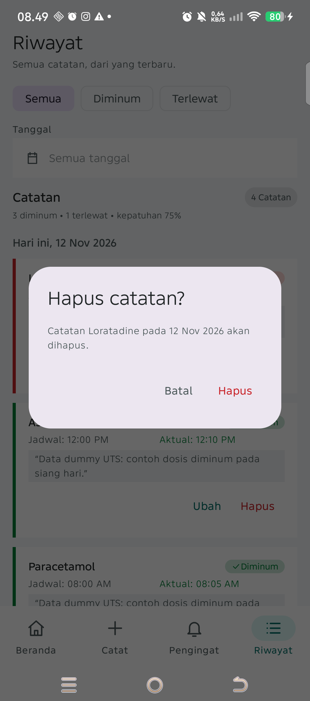
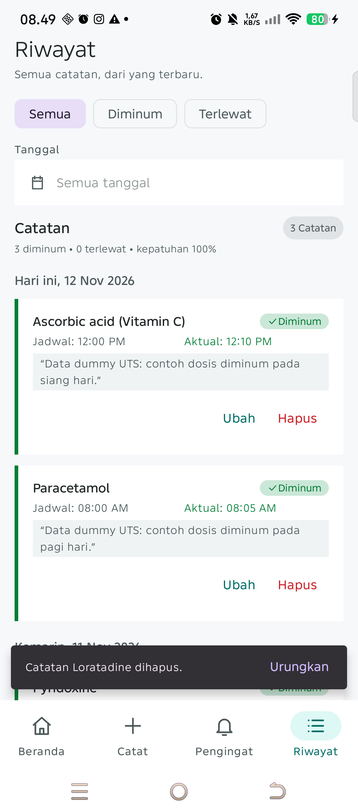
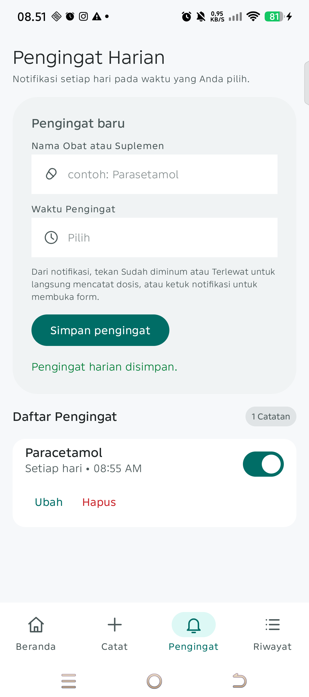

# MediTrack

Aplikasi Android untuk mencatat konsumsi obat dan mengatur pengingat.

Proyek UTS Pemrograman Bergerak, kelompok 05 / HT-05, Program Studi Sistem Informasi, Universitas Ma Chung. Status: dokumentasi persiapan; identitas anggota dan hasil pengujian manual masih perlu dilengkapi.

## Masalah dan pengguna

Pengguna dapat lupa apakah obat sudah diminum. MediTrack membantu pengguna dan pendamping mencatat nama obat, jadwal, waktu aktual, status diminum/terlewat, dan catatan. Proyek menggunakan data simulasi untuk pembelajaran dan self-monitoring. Aplikasi tidak menentukan dosis, terapi, atau keputusan klinis. Saran nama merupakan pencocokan teks dari katalog, bukan rekomendasi pengobatan.

## Fitur

Aplikasi memiliki empat halaman pada navigasi bawah. Tombol Kembali dari halaman lain kembali ke Beranda.

- **Beranda**: ringkasan **hari ini** (Terdaftar, Diminum, Terlewat, Kepatuhan %), progres, dan daftar catatan hari ini. Saat belum ada catatan sama sekali, tampil empty state "Belum ada catatan" dengan tombol **Catat obat** dan **Isi data contoh**.
- **Catat**: form berisi nama obat/suplemen (dengan saran dari katalog), **Tanggal**, Waktu Jadwal, Waktu Aktual, status Diminum/Terlewat, catatan, **Tambah Catatan**, dan **Reset**. Form yang sama dipakai untuk mengubah catatan (**Simpan Perubahan** / **Batal**). Draf form tetap ada saat berpindah halaman.
- **Pengingat**: pengingat harian dengan nama dan waktunya sendiri, terpisah dari form catatan. Pengingat dapat diubah, dinonaktifkan, atau dihapus.
- **Riwayat**: semua catatan dikelompokkan per tanggal (Hari ini, Kemarin, lalu tanggal), dari yang terbaru. Filter status (Semua/Diminum/Terlewat) dan tanggal, ringkasan hasil filter, tombol **Ubah** dan **Hapus** (dengan konfirmasi dan **Urungkan**).
- **Notifikasi pengingat** memiliki tombol **Sudah diminum** dan **Terlewat** yang langsung menyimpan catatan untuk hari itu. Menekan tombol dua kali atau mengganti pilihan memperbarui catatan yang sama, bukan menambah duplikat. Mengetuk notifikasi membuka halaman Catat dengan nama, jadwal, dan waktu aktual (waktu saat ini) yang sudah terisi.
- Pencarian nama pada katalog lokal berisi 30 nama; nama di luar katalog tetap dapat diketik.
- Tiga data contoh (Paracetamol, Ascorbic acid (Vitamin C), dan Loratadine; dua Diminum dan satu Terlewat, persentase 66% karena pecahan dibuang) hanya ditambahkan saat tombol **Isi data contoh** ditekan, dengan tanggal hari itu.
- Seluruh teks antarmuka berada di `res/values/strings.xml`.

Terdaftar menghitung jumlah **catatan hari ini**, bukan jumlah pengingat aktif. Menyimpan pengingat tidak otomatis membuat catatan; catatan dibuat dari form atau tombol pada notifikasi.

## Model data dan penyimpanan

Model utama: `MedicationRecord`.

| Properti | Tipe | Keterangan |
| --- | --- | --- |
| id | String | Identitas catatan (unik) |
| name | String | Nama/alias obat |
| scheduledTime | String | Jadwal, format 12 jam |
| actualTime | String? | Waktu aktual; null untuk Terlewat |
| status | DoseStatus | Enum TAKEN atau MISSED |
| note | String | Catatan opsional |
| date | String | Tanggal dosis, `yyyy-MM-dd` waktu lokal |

Room menyimpan semua data dalam satu berkas `meditrack.db` di direktori internal aplikasi, berisi tabel `medication_records`, `medicines` (katalog), dan `reminders`. Versi database 2. Migrasi dari versi 1:

- membuat ulang tabel catatan dengan kolom `date` dan ID unik; catatan lama diberi tanggal hari pembaruan karena versi 1 tidak menyimpan tanggal;
- mengganti nama dummy versi lama ("Obat Simulasi A/B/C");
- membuat tabel katalog dan pengingat. Pengingat dari berkas lama `medication-reminders.db` disalin dengan ID yang sama, lalu berkas lama dan `medicine-catalog.db` dihapus.

Catatan diurutkan dari tanggal terbaru, lalu dari yang terakhir ditambahkan. Mengubah catatan tidak memindahkan posisinya dalam hari yang sama.

Persentase = Diminum / jumlah catatan × 100, dibulatkan ke bawah; ketika tidak ada catatan nilainya 0%. State form menggunakan Compose dan rememberSaveable; data tersimpan diamati melalui Flow.

## Validasi

- Nama wajib diisi dan tidak hanya spasi; maksimal 60 karakter.
- Tanggal default hari ini dan tidak boleh melewati hari ini (pemilih tanggal juga menonaktifkan hari berikutnya).
- Waktu Jadwal wajib dipilih melalui pemilih waktu.
- Waktu Aktual wajib untuk Diminum; dikosongkan dan dinonaktifkan untuk Terlewat.
- Catatan opsional, maksimal 160 karakter.
- Simpan yang tidak valid menampilkan kesalahan. Form direset setelah penyimpanan berhasil; kegagalan penyimpanan mempertahankan input. Pesan gagal hilang saat input diubah atau Reset ditekan.
- Tidak ada kolom jumlah/dosis numerik. Skenario angka negatif dan huruf pada kolom angka perlu dicatat sebagai tidak berlaku, bukan dilaporkan lulus.

## Menjalankan di Windows

1. Siapkan Android Studio beserta Android SDK yang diminta proyek.
2. Hubungkan HP dengan **USB debugging** aktif, lalu izinkan koneksi pada HP. Emulator Android Studio juga dapat digunakan.
3. Buka PowerShell di folder proyek dan jalankan:

```powershell
.\run-android.ps1
```

Skrip menggunakan Java Android Studio, menjalankan build dan tes unit, memasang APK, lalu membuka MediTrack. Data aplikasi yang sudah ada dipertahankan saat pemasangan ulang.

Jika Java dipasang di lokasi lain atau ada beberapa perangkat:

```powershell
.\run-android.ps1 -JavaHome 'C:\lokasi\jdk' -DeviceId 'serial-perangkat'
```

Untuk build dan tes tanpa memasang aplikasi:

```powershell
.\run-android.ps1 -BuildOnly
```

APK debug: `app/build/outputs/apk/debug/app-debug.apk`.

Di Android Studio, buka folder proyek, gunakan JDK bawaan Android Studio pada pengaturan Gradle, pilih perangkat, kemudian klik **Run app**.

Konfigurasi proyek saat ini: compile/target SDK 37, minimum SDK 24. Lingkungan yang berhasil dipakai adalah JDK bawaan Android Studio (Java 25). Sinkronisasi pertama memerlukan internet untuk mengunduh dependensi.

## Pengujian dan dokumentasi

- [Skenario dan hasil pengujian](test-cases.md)
- [Pembagian tugas dan bukti kontribusi](CONTRIBUTIONS.md)
- [Penggunaan AI](AI_USAGE.md)
- [Bahan presentasi dan defense](PRESENTATION.md)
- [Daftar persiapan pengumpulan](submission-checklist.md)

Pada 12 November 2026 (versi dengan navigasi, tanggal, dan database gabungan) build debug, build APK tes perangkat, dan lint berhasil; unit test lokal mencatat 27 tes tanpa kegagalan. Tes perangkat (`app/src/androidTest`) juga lulus pada TECNO CM7 Android 16: 15 tes, 0 gagal. Notifikasi pengingat belum terbukti muncul pada perangkat. Batas cakupan bukti dan skenario manual yang belum dicatat dijelaskan dalam dokumen pengujian.

## Wireframe dan screenshot

[Wireframe awal](wireframe.png). Angka dan isi pada wireframe adalah rancangan awal.

Screenshot versi 12 November 2026 (TECNO CM7, data simulasi). Keterangan lengkap dan batasannya ada di [screenshots/README.md](screenshots/README.md).

| Beranda kosong | Beranda dengan data contoh | Validasi | Saran nama |
| --- | --- | --- | --- |
|  |  |  |  |

| Riwayat dengan filter | Konfirmasi hapus | Hapus dan Urungkan | Pengingat |
| --- | --- | --- | --- |
|  |  |  |  |

Arsip versi awal (`legacy-01.jpeg` sampai `legacy-03.jpeg`) tetap disimpan di folder screenshots.

## Batasan UTS dan rencana UAS

PDF UTS meminta data sementara dan empty state saat aplikasi pertama dibuka. Instalasi baru kini menampilkan empty state; tiga dummy hanya ditambahkan melalui tombol **Isi data contoh**. Data tetap disimpan dengan Room, bukan data sementara; perbedaan ini perlu diselaraskan dengan ketentuan dosen. Pengguna versi lama yang sudah memiliki dummy tetap melihatnya setelah pembaruan.

Room, Flow/ViewModel, notifikasi, navigasi, dan CRUD catatan merupakan pengembangan di luar minimum UTS dan tidak otomatis menambah nilai. Navigasi dibuat dengan `NavigationBar` Material 3 dan state halaman, tanpa library Navigation Compose. Ide lanjutan: menandai dosis otomatis sebagai Terlewat bila notifikasi tidak ditanggapi, serta rekap mingguan/bulanan.

## APK pengumpulan

APK lokal hasil build ada di `app/build/outputs/apk/debug/app-debug.apk`. Paket unduhan belum disiapkan dalam tahap dokumentasi ini. Nama pengumpulan yang direncanakan: `UTS_PemrogramanBergerak_05_MediTrack.apk`. Tautan unduhan ditambahkan setelah APK final diunggah.
