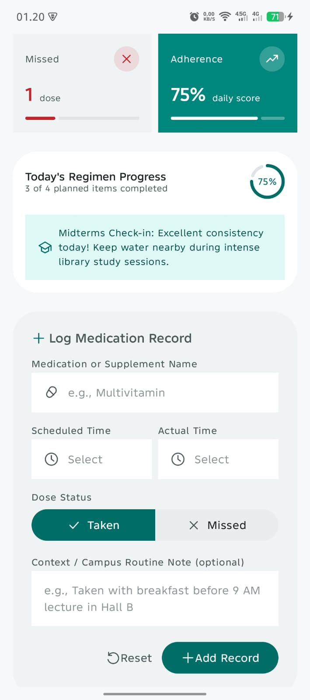
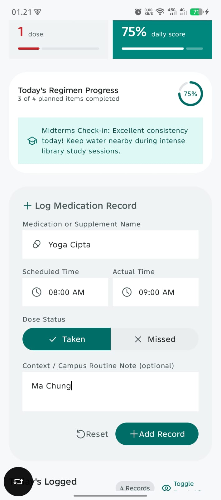
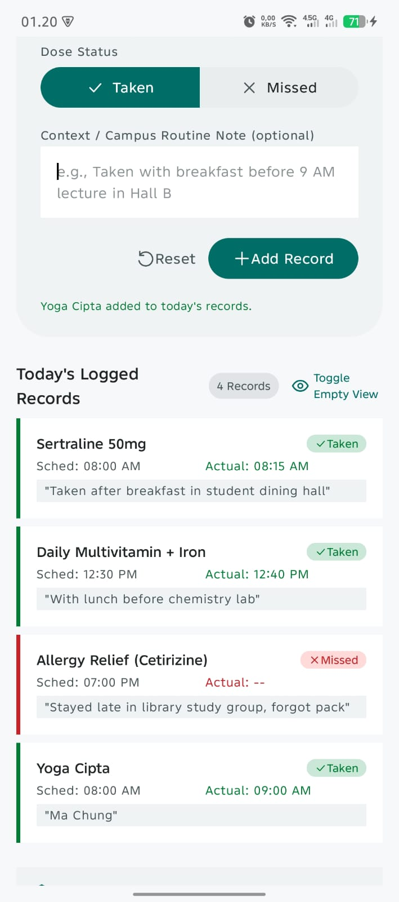

# MediTrack

Aplikasi Android untuk mencatat konsumsi obat dan mengatur pengingat.

Proyek UTS Pemrograman Bergerak, kelompok 05 / HT-05, Program Studi Sistem Informasi, Universitas Ma Chung. Status: dokumentasi persiapan; identitas anggota dan hasil pengujian manual masih perlu dilengkapi.

## Masalah dan pengguna

Pengguna dapat lupa apakah obat sudah diminum. MediTrack membantu pengguna dan pendamping mencatat nama obat, jadwal, waktu aktual, status diminum/terlewat, dan catatan. Proyek menggunakan data simulasi untuk pembelajaran dan self-monitoring. Aplikasi tidak menentukan dosis, terapi, atau keputusan klinis. Saran nama merupakan pencocokan teks dari katalog, bukan rekomendasi pengobatan.

## Fitur

- Form dengan nama obat/suplemen, pemilih waktu, status Taken/Missed, catatan, Add Record, dan Reset.
- Daftar catatan dalam Card menggunakan LazyColumn.
- Ringkasan Scheduled, Taken, Missed, dan persentase yang berubah mengikuti catatan tersimpan.
- Pencarian nama pada katalog lokal terpisah berisi 30 nama; nama di luar katalog tetap dapat diketik.
- Penyimpanan lokal dengan Room serta pengingat harian yang diatur di dalam form.
- Tiga data dummy: Paracetamol, Ascorbic acid (Vitamin C), dan Loratadine. Dua Taken dan satu Missed; persentase awal 66% karena tampilan membuang pecahan.

Scheduled menghitung jumlah **catatan**, bukan jumlah pengingat aktif. Ringkasan mencakup seluruh catatan tersimpan, belum difilter per tanggal. Menyimpan pengingat tidak otomatis membuat catatan Taken/Missed.

## Model data dan penyimpanan

Model utama: `MedicationRecord`.

| Properti | Tipe | Keterangan |
| --- | --- | --- |
| id | String | Identitas catatan |
| name | String | Nama/alias obat |
| scheduledTime | String | Jadwal, format 12 jam |
| actualTime | String? | Waktu aktual; null untuk Missed |
| status | DoseStatus | Enum TAKEN atau MISSED |
| note | String | Catatan opsional |

Room menyimpan data di direktori internal aplikasi pada perangkat: `meditrack.db` untuk catatan, `medicine-catalog.db` untuk katalog, dan `medication-reminders.db` untuk pengingat. Data bertahan saat aplikasi dibuka kembali. Tiga dummy memakai ID tetap sehingga tidak berulang saat aplikasi dibuka. Nama dummy versi lama diperbarui tanpa mengganti catatan lain.

Persentase = Taken / jumlah catatan × 100; ketika daftar kosong nilainya 0%. State form menggunakan Compose dan rememberSaveable; data tersimpan diamati melalui Flow.

## Validasi

- Nama wajib diisi dan tidak hanya spasi; maksimal 60 karakter.
- Scheduled Time wajib dipilih melalui pemilih waktu.
- Actual Time wajib untuk Taken; dikosongkan dan dinonaktifkan untuk Missed.
- Catatan opsional, maksimal 160 karakter.
- Simpan yang tidak valid menampilkan kesalahan. Form direset setelah penyimpanan berhasil; kegagalan penyimpanan mempertahankan input.
- Tidak ada kolom jumlah/dosis numerik. Skenario angka negatif dan huruf pada kolom angka perlu dicatat sebagai tidak berlaku, bukan dilaporkan lulus.

## Menjalankan di Windows

1. Siapkan Android Studio beserta Android SDK yang diminta proyek.
2. Hubungkan HP dengan **USB debugging** aktif, lalu izinkan koneksi pada HP. Emulator Android Studio juga dapat digunakan.
3. Buka PowerShell di folder proyek dan jalankan:

```powershell
.\run-android.ps1
```

Skrip menggunakan Java Android Studio, menjalankan build dan tes unit, memasang APK, lalu membuka MediTrack. Data aplikasi yang sudah ada dipertahankan saat pemasangan ulang.

Jika Java dipasang di lokasi lain atau ada beberapa perangkat:

```powershell
.\run-android.ps1 -JavaHome 'C:\lokasi\jdk' -DeviceId 'serial-perangkat'
```

Untuk build dan tes tanpa memasang aplikasi:

```powershell
.\run-android.ps1 -BuildOnly
```

APK debug: `app/build/outputs/apk/debug/app-debug.apk`.

Di Android Studio, buka folder proyek, gunakan JDK bawaan Android Studio pada pengaturan Gradle, pilih perangkat, kemudian klik **Run app**.

Konfigurasi proyek saat ini: compile/target SDK 37, minimum SDK 24. Lingkungan yang berhasil dipakai adalah JDK bawaan Android Studio (Java 25). Sinkronisasi pertama memerlukan internet untuk mengunduh dependensi.

## Pengujian dan dokumentasi

- [Skenario dan hasil pengujian](test-cases.md)
- [Pembagian tugas dan bukti kontribusi](CONTRIBUTIONS.md)
- [Penggunaan AI](AI_USAGE.md)
- [Bahan presentasi dan defense](PRESENTATION.md)
- [Daftar persiapan pengumpulan](submission-checklist.md)

Build debug terakhir berhasil pada 29 Oktober 2026. Laporan unit test lokal mencatat 11 tes, tanpa kegagalan atau error. Dua pengujian database terakhir juga lulus pada perangkat TECNO CM7. Batas cakupan bukti dan skenario manual yang belum dicatat dijelaskan dalam dokumen pengujian.

## Wireframe dan screenshot

[Wireframe awal](wireframe.png). Angka dan isi pada wireframe adalah rancangan awal.

Tiga gambar berikut merupakan **arsip versi awal**, belum merepresentasikan fitur Room, reminder terintegrasi, serta nama dummy terbaru. Ganti dengan tangkapan versi akhir sebelum pengumpulan.







## Batasan UTS dan rencana UAS

PDF UTS meminta data sementara dan empty state saat aplikasi pertama dibuka. Versi ini sudah menggunakan Room dan mengisi tiga dummy secara otomatis atas permintaan pengembangan. Komponen empty state tersedia dan diuji dengan daftar kosong, tetapi alur awal aplikasi produksi menampilkan dummy. Perbedaan ini perlu diselaraskan dengan ketentuan dosen; jangan menyatakan seluruh alur UTS sudah sama persis.

Room, Flow/ViewModel, dan notifikasi merupakan pengembangan di luar minimum UTS dan tidak otomatis menambah nilai. Catatan saat ini mendukung tambah dan tampil; edit/hapus catatan serta filter riwayat belum tersedia. Rencana UAS: CRUD catatan lengkap, halaman daftar/form/detail, navigasi, filter tanggal/status, dan rekap dari database.

## APK pengumpulan

APK lokal hasil build ada di `app/build/outputs/apk/debug/app-debug.apk`. Paket unduhan belum disiapkan dalam tahap dokumentasi ini. Nama pengumpulan yang direncanakan: `UTS_PemrogramanBergerak_05_MediTrack.apk`. Tautan unduhan ditambahkan setelah APK final diunggah.
